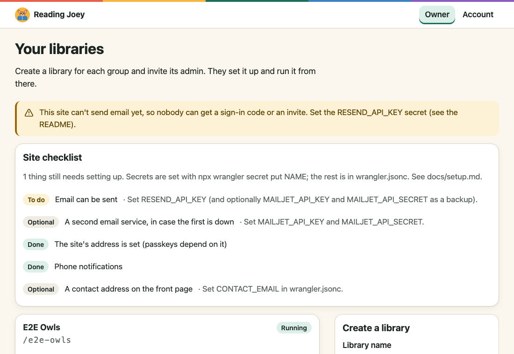
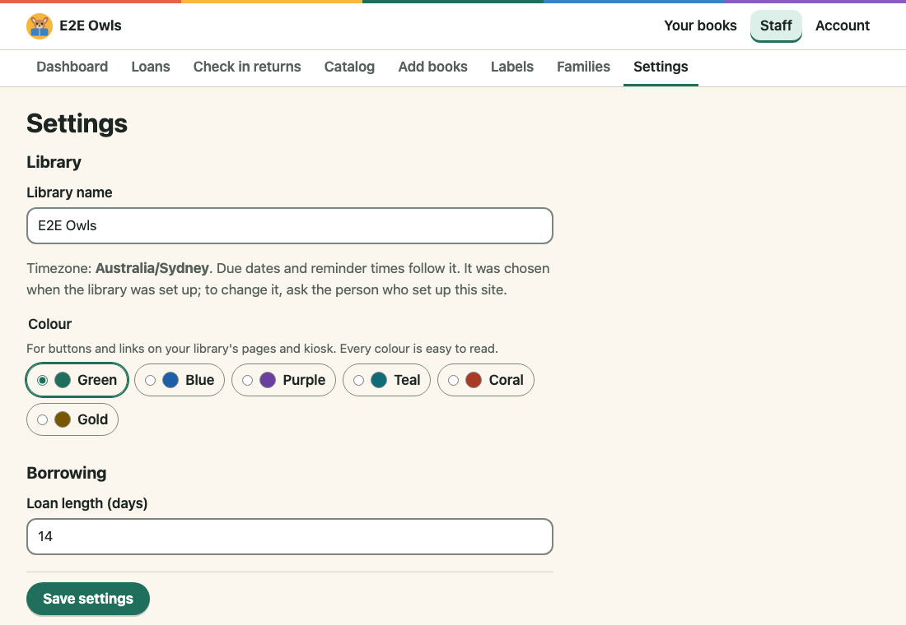
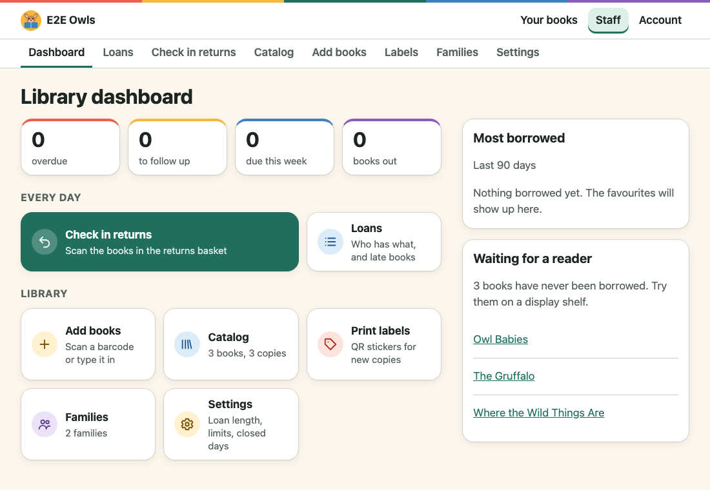
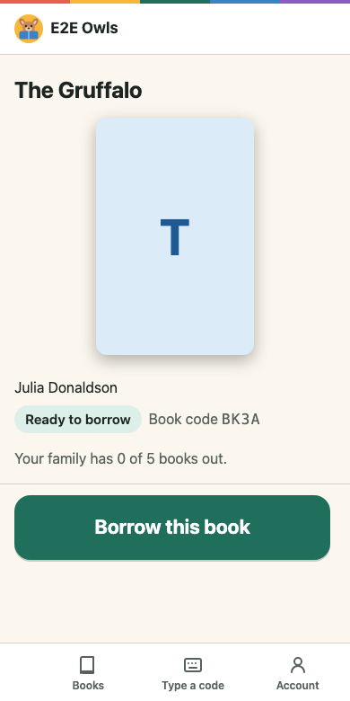

# Setting up your own Reading Joey site

This guide takes you from nothing to a working site for your libraries. You
don't need to be a developer, but you'll copy a few commands into a terminal.
Allow about 30 minutes, plus waiting time for your domain's email checks.

You need:

- A computer with [Node.js](https://nodejs.org) 24 or later and
  [git](https://git-scm.com/downloads). On Windows, use PowerShell.
- A free [Cloudflare](https://dash.cloudflare.com/sign-up) account (hosting
  and the database).
- A domain name, such as `library.example.org`, added to Cloudflare and showing
  as **Active** there. Buying it through Cloudflare Registrar is the simplest.
  The site is published on that domain only (not on a `workers.dev` address),
  so this has to be in place before you deploy.
- A free [Resend](https://resend.com) account, for email.

## 1. Get the code

```bash
git clone https://github.com/virajsenevirathne/community_library.git
cd community_library
npm install
npx wrangler login
```

`npm install` takes a few minutes. `wrangler login` opens your browser to
connect to your Cloudflare account: choose **Allow**.

Every command from here on runs in the `apps/web` folder:

```bash
cd apps/web
```

If you open a new terminal later, go back to it first (`cd community_library/apps/web`).

## 2. Choose your address, and create the database

Choose the address people will use, and keep it: passkeys (Face ID sign-in)
only work on the address they were saved on.

```bash
# "oc" puts the database near Australia and New Zealand. Others: wnam, enam, weur, eeur, apac.
npx wrangler d1 create community-library --location oc
```

Open `apps/web/wrangler.jsonc`. It comes with the values of the original site
(readingjoey.com): **change every one of these**, or the deploy goes to someone
else's address.

| Setting                        | Change it to                                             |
| ------------------------------ | -------------------------------------------------------- |
| `routes` → `pattern`           | your address, such as `library.example.org`              |
| `d1_databases` → `database_id` | the id the command above printed                         |
| `vars` → `APP_URL`             | `https://` and your address                              |
| `vars` → `EMAIL_FROM`          | an address on your domain, such as `library@example.org` |
| `vars` → `LIBRARY_NAME`        | your site's name                                         |
| `vars` → `CONTACT_EMAIL`       | where "Ask for a library" emails go, or leave it empty   |

## 3. Set up email

1. In Resend, add your domain and follow its steps to add the DNS records.
   With the domain on Cloudflare, Resend can add them for you. Checking them
   can take from minutes to a few hours: wait until Resend says **Verified**.
2. Create an API key in Resend, then:

   ```bash
   npx wrangler secret put RESEND_API_KEY
   ```

   Paste the key when asked. (Optional: a free Mailjet account as a backup,
   with `MAILJET_API_KEY` and `MAILJET_API_SECRET`.)

Gmail can't be used: the site sends its email through Resend (or Mailjet), not
through an email account. Email has to work before step 6, since signing in
needs an emailed code.

## 4. Set the other secrets

```bash
# Prints long random text, for the secrets below:
node -e "console.log(require('node:crypto').randomBytes(32).toString('base64'))"

# Signs everyone's sign-in: paste random text when asked.
npx wrangler secret put BETTER_AUTH_SECRET

# A one-time code that lets only you set the site up (16 characters or more;
# a shorter one stops setup). Paste fresh random text when asked.
npx wrangler secret put SETUP_CODE
```

Keep both in a password manager. Optional, for phone notifications:

```bash
npm run vapid-keys               # prints two keys
npx wrangler secret put VAPID_PUBLIC_KEY
npx wrangler secret put VAPID_PRIVATE_KEY
```

## 5. Deploy

```bash
npm run deploy
```

This builds the site, brings the database up to date and publishes it. The
first time, it asks whether to apply the database changes: answer **yes**. Run
the same command whenever you update the code.

## 6. Set up the site, then your first library

1. Open your address and sign in with your email. The site asks for the
   setup code from step 4: you become the site's owner.
2. Your owner page shows a **Site checklist**. Anything marked "To do" says
   what to set.

   

3. Create a library and invite its admin (that can be you). The admin opens
   the email and signs in. The library first asks how returns work and for the
   terms to be accepted; everything else (loan length, books per family, closed
   days, its colour and logo) is in **Settings**.

   

4. The admin adds books (scan the barcode on the back), prints the QR stickers
   (Labels), and shares the sign-up link or poster with families. The
   dashboard then shows what's out and what's late:

   

Families then scan a sticker with their phone camera to borrow:



## 7. Before families join

- [ ] In Cloudflare, under your domain's **SSL/TLS › Edge Certificates**, turn
  on **Always Use HTTPS**.
- [ ] Turn on the weekly backups: [backups.md](backups.md).
- [ ] Read the privacy notice and terms at `/privacy` and `/terms`, and have
  them checked for your country before you rely on them.

## Updating

From the `community_library` folder:

```bash
git pull
npm install
npm run deploy -w @community-library/web
```

## If something goes wrong

- **Nobody gets a sign-in code:** the checklist's "Email can be sent" item, and
  in Resend, check the domain is verified.
- **Passkeys stop working:** the address changed. Use the address in
  `APP_URL`; passkeys saved elsewhere need saving again.
- **Reminders stop:** each library's dashboard warns when the hourly job
  hasn't run. Check **Workers › your Worker › Triggers** in
  Cloudflare.
